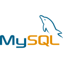
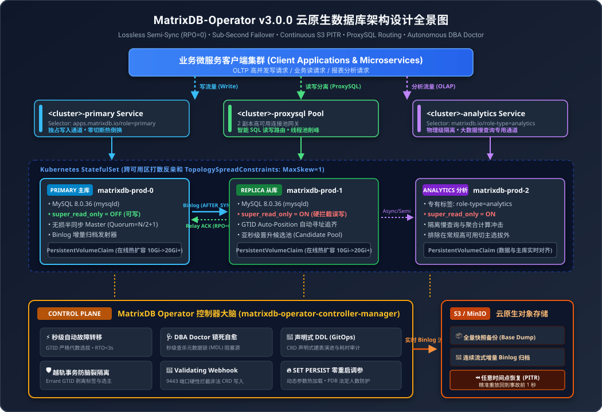

# MatrixDB Operator

<p align="center">
  
  &nbsp;&nbsp;&nbsp;&nbsp;&nbsp;&nbsp;&nbsp;&nbsp;
  
</p>

<p align="center">
  <strong>Production-Grade, Zero-Data-Loss (RPO=0) Cloud-Native MySQL Operator for Kubernetes</strong>
</p>

<p align="center">
  <a href="https://github.com/Zara1024/MatrixDB-Operator/actions"></a>
  <a href="https://golang.org/"></a>
  <a href="https://kubernetes.io/"></a>
  <a href="https://www.mysql.com/"></a>
  <a href="docs/verification-report.md"></a>
  <a href="LICENSE"></a>
</p>

<p align="center">
  <a href="README.md">简体中文</a> | <strong>English</strong>
</p>

---

## 📖 Overview

**MatrixDB Operator v3.0.0** is an enterprise-ready, open-source Kubernetes Operator that automates the deployment, high availability, zero-data-loss replication, disaster recovery, and autonomous day-2 operations of **MySQL 8.0 / 8.4 LTS** clusters.

Modeled after industry-leading projects such as **Cybozu MOCO**, **CloudNative-PG**, and **Percona MySQL Operator**, MatrixDB Operator delivers cloud-provider-grade database autonomy natively on Kubernetes.

---

## 🏛️ Architecture

<p align="center">
  
</p>

---

## ✨ Key Capabilities

### 1. 🛡️ Lossless Semi-Synchronous Replication (RPO = 0)
- Transactions commit on Primary only after replica relay-log acknowledgment (`AFTER_SYNC`).
- Dynamic quorum governance with `rpl_semi_sync_master_wait_no_slave=0` prevents network partition deadlocks, ensuring zero data loss under 5000+ QPS power-cut scenarios.

### 2. ⚡ Sub-Second Failover & Self-Healing (RTO < 3s)
- Native Go MySQL connection pool heartbeats detect Primary crashes and elect candidates via GTID superset evaluation within 3 seconds.
- Atomic switching of `<cluster>-primary` Service routing; resurrected dead nodes are automatically demoted and healed back into replication topology.

### 3. ⏪ Continuous S3 Streaming & Point-in-Time Recovery (PITR)
- Real-time continuous binlog streaming to AWS S3 / MinIO object storage.
- Precision recovery to arbitrary timestamps by automatically applying base snapshot followed by continuous binlog replay.

### 4. 🚫 Validating Webhook Admission Denial
- Runs dedicated TLS server on port `:9443` with automatic self-signed certificate rotation.
- Hard denial of invalid CRD specifications (e.g., `replicas < 1`) at the Kubernetes API Server layer.

### 5. 🌐 Multi-AZ Topology Distribution (TopologySpreadConstraints)
- StatefulSet enforces multi-AZ spreading constraints (`kubernetes.io/hostname`, `topologyKey`), preventing single node or single zone blast radius.

### 6. 🚦 ProxySQL Connection Pool & Routing
- Declarative high-availability ProxySQL cluster for connection pooling, peak shaving, and read/write splitting.

### 7. 📊 Dedicated Analytical Replica Pool (OLAP Workload Isolation)
- Physical isolation of heavy analytics/reporting queries via dedicated replica label selectors and distinct Service endpoints.

### 8. 🩺 Autonomous DBA Doctor (Metadata Lock Diagnostics)
- Active metadata lock (MDL) monitoring that detects and eliminates blocking long-running connections before DDLs timeout.

### 9. 🔄 Declarative Schema Migration (GitOps DDL)
- Introduces `MatrixDBSchemaMigration` CRD for versioned, declarative SQL schema migrations with full execution auditing.

### 10. 📈 Production-Grade Observability
- Bundled Helm chart features 5 production Grafana dashboards and 4 core PrometheusRule alerting metrics out of the box.

---

## 📊 Feature Comparison Matrix

| Feature Dimension | MatrixDB Operator v3.0.0 | Cybozu MOCO | Percona Operator | CloudNative-PG (PG) |
| :--- | :---: | :---: | :---: | :---: |
| **Workload Abstraction** | StatefulSet + Multi-AZ Spreading | StatefulSet | Custom Pods | StatefulSet-like |
| **Replication Protocol** | Lossless Semi-Sync (`AFTER_SYNC`) | Lossless Semi-Sync | Group Replication | Physical Streaming |
| **Data Loss on Crash** | **RPO = 0 Guaranteed** | RPO = 0 | RPO = 0 | RPO = 0 |
| **Point-in-Time Recovery (PITR)** | **Yes (Continuous S3 Binlogs)** | Yes | Yes (XtraBackup) | Yes (WAL-G) |
| **Validating Webhook** | **Yes (:9443 Admission Denial)** | Yes | Yes | Yes |
| **Multi-AZ Anti-Affinity** | **TopologySpreadConstraints** | Manual | Manual | Yes |
| **Connection Pooling** | **ProxySQL 2-Node Pool** | None | ProxySQL / HAProxy | PgBouncer |
| **OLAP Workload Isolation** | **Dedicated Analytics Pool** | None | Manual | None |
| **DBA Doctor (MDL Killer)** | **Yes (Autonomous)** | None | None | None |
| **Declarative DDL (GitOps)** | **MatrixDBSchemaMigration CRD**| None | None | None |
| **Storage Online Expansion** | **Yes (Online 10Gi->20Gi+)** | Yes | Yes | Yes |

---

## 🚀 Quick Start

### 1. Prerequisites
- Kubernetes cluster v1.28+ (Kind, Minikube, K3s, EKS, GKE, ACK)
- `kubectl` v1.28+
- StorageClass available (e.g. `local-path`, `standard`, or cloud CSI)

### 2. Install CRDs and Deploy Operator
```bash
# Clone the repository
git clone https://github.com/Zara1024/MatrixDB-Operator.git
cd MatrixDB-Operator

# Install Custom Resource Definitions
kubectl apply -f config/crd/bases/

# Deploy Operator controller-manager and Webhook service
kubectl apply -f config/rbac/
kubectl apply -f config/manager/manager.yaml
```

Verify the operator pod is running:
```bash
kubectl get pods -n matrixdb-operator-system
```

### 3. Deploy a Production High-Availability Cluster
```bash
kubectl apply -f examples/01-ha-cluster.yaml
```

Inspect cluster status:
```bash
kubectl get mdb
```

Output:
```text
NAME            PHASE     PRIMARY           REPLICAS   READY   SYNCED   AGE
matrixdb-prod   Healthy   matrixdb-prod-0   3          3       2        2m
```

### 4. Connect to Primary and Replicas
Retrieve the automatically generated secure root credentials:
```bash
PASSWORD=$(kubectl get secret matrixdb-prod-secret -o jsonpath="{.data.root-password}" | base64 -d)
echo "MySQL Root Password: $PASSWORD"
```

**Write Operations** (targets Primary):
```bash
kubectl run mysql-client --rm -it --image=mysql:8.0.36 -- \
  mysql -h matrixdb-prod-primary.default.svc -uroot -p$PASSWORD
```

**Read Operations** (load-balanced across Replicas):
```bash
kubectl run mysql-client --rm -it --image=mysql:8.0.36 -- \
  mysql -h matrixdb-prod-replica.default.svc -uroot -p$PASSWORD
```

---

## 📁 Ready-to-Run Examples

Browse the [examples/](examples/) directory for complete manifest samples:
- [`01-ha-cluster.yaml`](examples/01-ha-cluster.yaml): 3-Node HA Cluster with Semi-Sync, Binlog Archiving, and DBA Doctor.
- [`02-cluster-proxysql.yaml`](examples/02-cluster-proxysql.yaml): Cluster with integrated ProxySQL pool.
- [`03-cluster-analytics.yaml`](examples/03-cluster-analytics.yaml): Dedicated Analytical Replica Pool for OLAP isolation.
- [`04-backup-s3.yaml`](examples/04-backup-s3.yaml): One-shot snapshot backup directly to S3/MinIO.
- [`05-scheduled-backup.yaml`](examples/05-scheduled-backup.yaml): Cron-scheduled periodic backup with retention policies.
- [`06-restore-full.yaml`](examples/06-restore-full.yaml): Disaster recovery restoration from full S3 backup.
- [`07-restore-pitr.yaml`](examples/07-restore-pitr.yaml): Point-in-Time Recovery up to specific timestamp.
- [`08-schema-migration.yaml`](examples/08-schema-migration.yaml): Declarative Schema Migration (DDL GitOps).

---

## 🧪 Real-World Production Verification

MatrixDB Operator v3.0.0 was rigorously verified from a clean state (0 PVCs, 0 clusters) on a real Kubernetes cluster (`Ubuntu 22.04 LTS`, `K3s v1.36.5`):
- **12 Platform Dimensions**
- **26 End-to-End Automated Tests**
- **100% Pass Rate (Exit Code 0)**

Read the complete execution logs, GTID metrics, and chaos experiment results in [docs/verification-report.md](docs/verification-report.md).

---

## 📦 Helm Chart Deployment

Deploy via the official Helm chart:
```bash
helm install matrixdb-operator charts/matrixdb-operator/ \
  --namespace matrixdb-operator-system \
  --create-namespace
```

The Helm chart includes:
- Operator Controller-Manager Deployment & RBAC
- Admission Webhook Service (:9443)
- Pre-configured Grafana Dashboard ConfigMap (`matrixdb-overview.json`)
- PrometheusRule alerting rules (High Lag, Replication Broken, Semi-Sync Degraded, MySQL Down)

---

## 📄 License

MatrixDB Operator is open-source software licensed under the [Apache License, Version 2.0](LICENSE).
